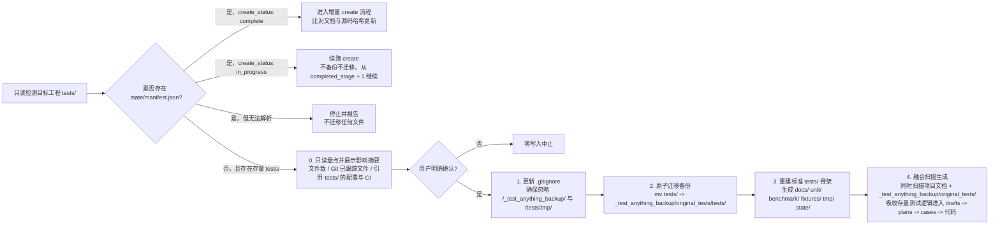
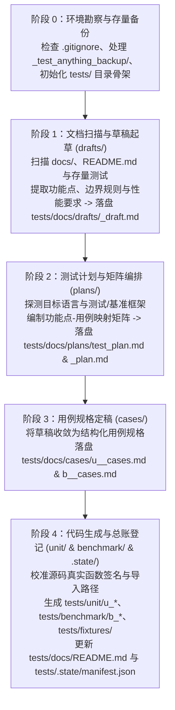
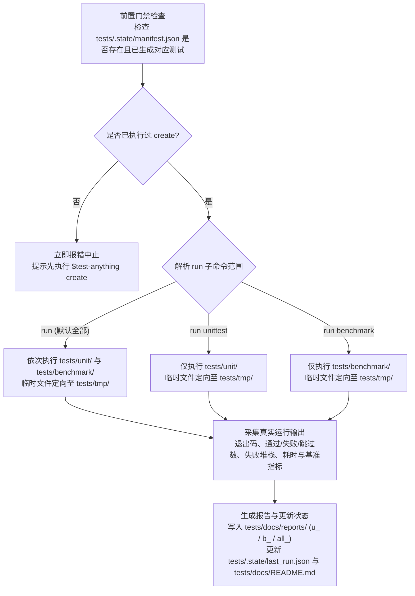

# test-anything: 文档驱动的全栈测试生成与执行技能

面向 AI Agent 与开发者的文档驱动测试技能：通过扫描目标工程文档中的功能点并结合源码调用契约，在项目根目录下构建标准化 `tests/` 体系，自动完成从**功能点测试草稿（`drafts`）→ 测试计划（`plans`）→ 用例规格（`cases`）→ 可执行单元测试（`unit`）与性能基准测试（`benchmark`）**的全流程生成、执行与报告归档。

当前设计版本：**0.1.0-draft**。架构风格参考同级技能 `knowledge-map`（证据追溯与渐进披露）与 `ad-flow`（存量安全备份与状态门禁）。

快速导航：[1. 简介与设计目标](#1-简介与设计目标) · [2. 命令体系与路由规约](#2-命令体系与路由规约) · [3. 目标工程 `tests/` 目录结构规范](#3-目标工程-tests-目录结构规范) · [4. 存量测试安全备份与融合机制](#4-存量测试安全备份与融合机制) · [5. 核心工作流设计 (`create` & `run`)](#5-核心工作流设计-create--run) · [6. 技能包仓库结构](#6-技能包仓库结构) · [7. 生成文档与测试代码内容格式规范](#7-生成文档与测试代码内容格式规范) · [8. 核心状态文件契约摘要](#8-核心状态文件契约摘要)

---

## 1. 简介与设计目标

`test-anything` 旨在解决工程项目中“文档描述的功能点缺乏对应测试覆盖、单元测试与基准测试组织混乱、测试文档与测试代码脱节”的问题。通过 `$test-anything` 父命令及其子命令体系，将测试的**规划设计、规格沉淀、代码生成、运行度量**统一收拢在目标工程根目录的 `tests/` 下。

### 1.1 核心设计原则

| 原则 | 在本项目中的落地 |
|---|---|
| **文档驱动功能点 + 源码校准契约** | 优先扫描项目 `docs/`（含 `docs/official/`）、`README.md` 及接口定义提取业务功能点、边界条件与性能指标；在生成可执行测试代码时结合源码真实函数签名、模块路径与类型定义，确保生成的测试可编译、可运行 |
| **草稿先行、四阶闭环 (`create`)** | `create` 内部按 **`drafts/`（起草）→ `plans/`（计划）→ `cases/`（规格）→ `unit/` & `benchmark/`（代码）** 流水线推进；草稿为第一落点；自阶段 0 起在 `manifest.json` 记录 `create_status` / `completed_stage`，中途受阻或中断时下次 `create` 从未完成阶段续跑 |
| **`create` 与 `run` 严格解耦** | `create` 负责全量生成测试资产（不设子选项）；`run` 仅负责执行已生成的测试并产出报告。未执行 `create` 时直接调用 `run` 立即报错中止，绝不隐式触发生成 |
| **存量资产零破坏备份 (`_test_anything_backup/`)** | 对齐 `ad-flow` 隔离快照机制：目标工程已有非受管 `tests/` 时，先展示影响摘要并经用户明确确认，再原子迁移至 `/_test_anything_backup/original_tests/tests/`（自动配置 `.gitignore`），并在 `create` 时融合吸收原有测试逻辑 |
| **真实执行与诚实报告 (`run`)** | 调用宿主真实测试运行器执行测试，临时产物强制收拢至 `tests/tmp/`；**严禁在 `run` 阶段篡改目标项目业务源码以“凑通过”**，如实记录通过率、失败堆栈与性能基准数据 |
| **全英文标识与 `u_` / `b_` 前缀分流** | `tests/docs/` 与代码目录统一采用英文标识命名，不拆分子目录区分单测与基准测试，统一通过文件名前缀 `u_`（unittest）与 `b_`（benchmark）标识类型 |

---

## 2. 命令体系与路由规约

在支持技能调用的宿主中，通过 `$test-anything`（或宿主适配的 `/test-anything`）触发。父命令支持 `help`、`create` 与 `run` 三大子命令/参数分支：

```text
$test-anything                        # 默认入口：初始化 tests/ 目录（含存量备份）并默认执行 create 全量生成
$test-anything help                   # 帮助入口（兼容 --help / -h）：只读输出命令语法、子命令说明与目录速查，不写任何文件
$test-anything create                 # 生成入口：扫描文档功能点与源码契约，按流水线全量生成/增量更新 unit 与 benchmark 用例
$test-anything run                    # 执行入口（默认全部）：依次执行 unittest 与 benchmark，输出全量与分项报告
$test-anything run unittest           # 执行子命令：仅执行 tests/unit/ 下的单元测试，更新 u_ 测试报告
$test-anything run benchmark          # 执行子命令：仅执行 tests/benchmark/ 下的基准测试，更新 b_ 测试报告
```

### 2.1 命令路由决策矩阵

| 调用命令 | 目标工程状态 | 实际执行行为 |
|---|---|---|
| `$test-anything help` / `--help` / `-h` | 任意状态 | **纯只读模式**：输出命令使用说明、`create` 与 `run` 解耦规则及 `tests/` 目录速查，不创建或修改任何文件 |
| `$test-anything`（裸调） | 首次接入（无 `tests/`） | 创建标准 `tests/` 目录骨架，自动执行 `create` 全流程 |
| `$test-anything`（裸调） | 已有非本技能创建的 `tests/` | 先只读展示影响摘要（文件数、Git 已跟踪文件及迁移后在 Git 视角等同删除的后果、引用 `tests/` 的配置与 CI），**经用户明确确认后**将原 `tests/` 原子备份至 `/_test_anything_backup/original_tests/tests/`，重建标准 `tests/` 并执行 `create`（融合旧测试与文档功能点）；未确认则零写入中止 |
| `$test-anything`（裸调） | 上次 `create` 中断（`manifest.json` 记录 `create_status: in_progress`） | 续跑：不备份、不迁移，从 `completed_stage + 1` 继续 `create` |
| `$test-anything`（裸调） | 已完成 `create`（`manifest.json` 记录 `create_status: complete`） | 默认执行 `create` 的增量扫描与更新流程 |
| `$test-anything`（裸调） | `manifest.json` 损坏（无法解析或 `schema_version` 无效） | 停止并报告，不迁移任何文件 |
| `$test-anything create` | 任意状态 | 同裸调行为；**不设 `unittest \| benchmark` 子参数**，始终全量覆盖单元测试与基准测试的生成/更新 |
| `$test-anything run` | 已完成 `create` | 执行 `tests/unit/` + `tests/benchmark/` 全部测试，在 `tests/docs/reports/` 生成 `u_`、`b_` 及全量汇总报告 |
| `$test-anything run unittest` | 已完成 `create` | 仅执行 `tests/unit/`，生成/更新 `u_` 单元测试报告与 `.state/last_run.json` |
| `$test-anything run benchmark` | 已完成 `create` | 仅执行 `tests/benchmark/`，生成/更新 `b_` 性能基准报告与 `.state/last_run.json` |
| `$test-anything run [unittest\|benchmark]` | **未完成 `create`**（无受管 `manifest.json`、`create_status: in_progress` 或无生成用例） | **直接报错中止**，提示用户先执行 `$test-anything` 或 `$test-anything create`，不自动触发 `create` |

---

## 3. 目标工程 `tests/` 目录结构规范

在目标工程根目录下生成的 `tests/` 采用精简、职责明确的顶层与文档子目录设计：

```text
<目标工程根目录>/
├── .gitignore                                # 自动确保忽略 /_test_anything_backup/ 与 /tests/tmp/
│
├── tests/                                    # 【test-anything 受管测试根目录】
│   ├── docs/                                 # 【测试文档中心】全部采用英文文件名，以 u_ / b_ 前缀区分类型
│   │   ├── README.md                         # 测试文档总导航：模块清单、覆盖率概览、功能点与用例映射索引
│   │   │
│   │   ├── drafts/                           # 【阶段 1：测试草稿区】扫描文档提取的功能点与候选测试草稿（第一落点）
│   │   │   ├── <module>_draft.md             # 模块综合功能点提取与测试候选草稿（含待确认边界与性能点）
│   │   │   ├── u_<module>_draft.md           # （可选细分）单元测试候选草稿
│   │   │   └── b_<module>_draft.md           # （可选细分）基准测试候选草稿
│   │   │
│   │   ├── plans/                            # 【阶段 2：测试计划区】测试范围、策略编排与追溯矩阵
│   │   │   ├── test_plan.md                  # 全局测试总计划（测试环境、框架选型、功能点-用例映射矩阵）
│   │   │   └── <module>_plan.md              # 按业务模块拆分的测试计划
│   │   │
│   │   ├── cases/                            # 【阶段 3：正式用例规格区】不分子目录，靠 u_ / b_ 前缀区分
│   │   │   ├── u_<module>_cases.md           # 模块单元测试规格（用例 ID、前置条件、输入、预期结果、源码/文档锚点）
│   │   │   └── b_<module>_cases.md           # 模块基准测试规格（用例 ID、负载规模、目标指标、预热/采样策略）
│   │   │
│   │   └── reports/                          # 【run 阶段：测试报告区】记录真实运行结果与性能数据
│   │       ├── all_report_latest.md          # 最近一次全量运行（run）汇总报告
│   │       ├── u_report_latest.md            # 最近一次单元测试（run unittest）报告
│   │       └── b_report_latest.md            # 最近一次基准测试（run benchmark）报告
│   │
│   ├── unit/                                 # 【阶段 4：可执行单元测试代码】
│   │   └── u_<module>_test.<ext>             # 按目标语言测试框架生成的单测代码（如 .py / .go / .spec.ts / .rs）
│   │
│   ├── benchmark/                            # 【阶段 4：可执行性能基准测试代码】
│   │   └── b_<module>_bench.<ext>            # 按目标语言基准框架生成的压测/基准代码
│   │
│   ├── fixtures/                             # 【公共测试夹具与数据区】
│   │   └── <module>_fixtures.<ext/json>      # 共享 Mock 桩、测试样本数据、黄金输入输出（Golden Files）
│   │
│   ├── tmp/                                  # 【临时文件隔离区】（加入 .gitignore）
│   │   └── ...                               # 测试编译产物、运行期临时文件、覆盖率原始转储与沙箱数据
│   │
│   └── .state/                               # 【受管状态与追踪元数据区】
│       ├── manifest.json                     # 核心总账：受管版本、文档哈希、功能点 <-> cases <-> 代码文件双向映射
│       ├── last_run.json                     # 最近一次 run 执行记录（时间、命令、退出码、通过率、基准摘要）
│       └── config.json                       # （可选）项目级测试偏好配置（自定义运行命令、忽略文档、超时阈值）
│
└── _test_anything_backup/                    # 【存量测试安全备份区】仅在项目已有存量测试或升级快照时生成（加入 .gitignore）
    ├── README.md                             # 备份区只读安全声明（严禁 AI 删除或覆盖）
    ├── original_tests/                       # 首次接入时原子迁移的原项目测试目录（如 original_tests/tests/）
    └── snapshots/                            # 后续重生成或重大版本变更时的按 <run_id> 独立快照
```

### 3.1 各子目录职责与命名契约

1. **`tests/docs/`（测试文档四阶闭环）**：
   - **全英文命名 + 前缀区分**：`docs/` 下所有文件均使用英文蛇形命名（`snake_case`），不额外嵌套 `unit/` 或 `benchmark/` 子目录，统一使用 **`u_`** 代表单元测试（Unit Test）、**`b_`** 代表性能基准测试（Benchmark）。
   - **`drafts/`**：`create` 扫描阶段的第一落点，记录从项目文档提取的原始功能点、输入输出规则及候选测试点。若文档存在歧义、缺少必要源码契约或用户中途中断，工作成果保留在 `drafts/` 中，`manifest.json` 保持 `create_status: in_progress`，下次 `create` 从未完成阶段续跑。
   - **`plans/`**：定义测试策略、测试框架与运行器命令、模块优先级，以及核心的**“文档章节/功能点 ↔ 用例 ID（`UT-xxx` / `BM-xxx`）↔ 源码符号”映射表**。
   - **`cases/`**：经校验后的正式测试规格书。每条 `u_` 用例包含唯一 ID、关联功能点、前置条件、测试步骤/输入、预期输出/断言、边界与异常场景；每条 `b_` 用例包含唯一 ID、被测热点路径、数据集规模、迭代/并发参数及关注指标（延迟 P50/P99、吞吐量 QPS/ops、内存分配）。
   - **`reports/`**：仅由 `run` 子命令根据真实运行结果写入，仅保留最近一次运行结果：每份报告（`*_latest.md`）每次运行原地覆盖，不按批次堆积历史文件。
2. **`tests/unit/` 与 `tests/benchmark/`（可执行测试代码）**：
   - 与 `tests/docs/cases/` 下的 `u_<module>_cases.md` 和 `b_<module>_cases.md` 按模块镜像对应。
   - 代码内部通过注释或测试名称显式标注对应的用例 ID（如 `UT-auth-001`、`BM-parser-001`），实现文档规格与测试代码的双向追溯。
3. **`tests/fixtures/`（公共测试夹具）**：
   - 存放跨用例复用的静态测试数据、Mock/Stub 辅助函数或构造器，避免在 `unit/` 和 `benchmark/` 中硬编码大段测试数据。
4. **`tests/tmp/`（运行时临时区）**：
   - 所有测试运行期间产生的临时目录、SQLite/文件沙箱、原始 coverage.out / benchmark.json 等中间产物强制输出至 `tests/tmp/`，保持源码树与 `tests/` 主目录洁净。
5. **`tests/.state/`（状态追踪区）**：
   - `manifest.json` 的 `create_status: complete` 是判断当前工程是否已完成 `create` 的唯一机器依据（`create_status` / `completed_stage` 同时记录续跑进度），记录每个源文档、源码文件及生成产物的 SHA-256 哈希，用于增量更新与外部修改冲突检测。

---

## 4. 存量测试安全备份与融合机制

当目标工程在首次执行 `$test-anything`（或 `$test-anything create`）时**已经存在非本技能管理的 `tests/` 目录**（或存量测试文件），严格执行对齐 `ad-flow` 的安全隔离与融合流程：



### 4.1 备份安全红线

1. **迁移前人工确认**：只读盘点存量 `tests/` 并展示影响摘要（文件数、Git 已跟踪文件数及迁入被忽略的备份区后在 Git 视角等同删除的后果、引用 `tests/` 的项目配置与 CI 文件、备份目标路径），取得用户在会话中的明确确认后才执行后续写入；调用命令本身、既往指令或沉默均不视为确认，未确认则零写入中止。
2. **先写 `.gitignore` 后建备份**：在创建 `/_test_anything_backup/` 前，检查目标项目根目录 `.gitignore`。若不存在则创建，若已存在则保留原内容并追加 `/_test_anything_backup/` 与 `/tests/tmp/`（已存在等效规则时不重复添加）。若旧 `tests/` 已被 Git 跟踪，须在迁移前的确认摘要中说明，不擅自修改 Git 索引。
3. **原子隔离（Atomic Move）**：严禁在原有的非受管 `tests/` 目录中直接原地混写或覆写文件。必须先执行原子移动至 `_test_anything_backup/original_tests/tests/`，并写入 `_test_anything_backup/README.md` 声明备份只读。
4. **存量测试盘点与吸收**：备份完成后，`create` 阶段不仅扫描项目文档（`docs/`、`README.md`），还会读取 `_test_anything_backup/original_tests/` 中的存量测试代码，将其已验证的业务断言、边界用例与夹具吸收转化为新体系下的 `u_` / `b_` 用例，在 `plans/test_plan.md` 中标注 `source: legacy_tests + docs`。
5. **严禁 AI 删除备份**：`/_test_anything_backup/` 下的所有原始测试与历史快照（`snapshots/<run_id>/`）对 AI 只读，仅允许由人类开发者在确认迁移无误后手动清理。

---

## 5. 核心工作流设计 (`create` & `run`)

### 5.1 `create` 四阶段生成流水线

执行 `$test-anything` 或 `$test-anything create` 时，宿主 AI 按以下四阶段顺序推进，并在一次调用内完成全量单元测试与基准测试生成：



| 阶段 | 核心输入 | 关键动作 | 交付产物 | 阻断与回退策略 |
|---|---|---|---|---|
| **Stage 0: Init & Backup** | 目标工程根目录 | 只读判定全新/续跑/增量/存量模式；若存在非受管 `tests/`，经用户明确确认后原子备份至 `_test_anything_backup/original_tests/`；创建 `tests/{docs,unit,benchmark,fixtures,tmp,.state}` 并写入 `create_status: in_progress` 的 `manifest.json` | 标准 `tests/` 目录树、`.gitignore`、备份区、进度 `manifest.json` | 用户未确认迁移、`manifest.json` 损坏或备份目标路径冲突时立即停止并报告，不覆盖已有备份 |
| **Stage 1: Draft** | `docs/`（含 `docs/official/`）、`README.md`、API 规范、`_test_anything_backup/original_tests/` | 识别业务模块与具体功能点，拆解正常路径、边界条件、异常分支（归入单测候选）及高耗时/高频吞吐路径（归入基准候选），**率先写入 `drafts/`** | `tests/docs/drafts/<module>_draft.md` | 若项目既无文档也无源码/存量测试，停留在空草稿并报告缺失来源 |
| **Stage 2: Plan** | `drafts/`、项目构建配置（如 `pyproject.toml`、`go.mod`、`package.json`、`Cargo.toml`） | 确定目标语言测试运行器与基准测试框架；建立“功能点 ↔ 用例 ID ↔ 目标源码符号”矩阵 | `tests/docs/plans/test_plan.md`、`tests/docs/plans/<module>_plan.md` | 若存在多个未决测试框架，优先沿用项目已有依赖或标准库框架并在计划中注明 |
| **Stage 3: Case** | `drafts/`、`plans/`、目标工程源码 | 核对每个候选功能点在源码中的实际实现状态，剔除幻觉接口，编写完备的 `u_` 单测规格与 `b_` 基准规格 | `tests/docs/cases/u_<module>_cases.md`、`tests/docs/cases/b_<module>_cases.md` | 若文档声明的功能在源码中尚未实现，在 `cases/` 中标记为 `status: unimplemented/todo`，不生成伪造通过的测试代码 |
| **Stage 4: Codegen** | `cases/`、目标工程源码模块导出与函数签名 | 生成可编译运行的 `tests/unit/u_<module>_test.*`、`tests/benchmark/b_<module>_bench.*` 及 `tests/fixtures/`；写入 `manifest.json` 与 `docs/README.md` | `unit/`、`benchmark/`、`fixtures/`、`docs/README.md`、`.state/manifest.json` | 静态语法检查不通过时在生成阶段局部修复测试代码（最多 3 轮）；不修改目标项目业务源码 |

#### 增量 `create` 更新规则

当目标项目已存在 `tests/.state/manifest.json` 时再次执行 `$test-anything` 或 `$test-anything create`：
1. 比对项目文档与源码文件的当前哈希与 `manifest.json` 记录值；
2. 仅重新起草和更新受变更影响的模块（`drafts` → `plans` → `cases` → `unit`/`benchmark`），未变更模块保持原文件与时间戳；
3. 若检测到用户手动修改了 `tests/unit/` 或 `tests/benchmark/` 下的某个受管文件（文件当前哈希与 `manifest.json` 不一致），先将该文件快照备份至 `_test_anything_backup/snapshots/<run_id>/`，并在合并更新时保留用户新增断言或提示冲突。

#### 中断续跑规则

每次 `create` 在阶段 0 结束时将 `manifest.json` 置为 `create_status: in_progress`，此后每个阶段对全部在范围模块完成后把 `completed_stage` 更新为该阶段号，阶段 4 完成后置为 `create_status: complete`。受阻或中断的阶段不推进 `completed_stage`；再次执行 `$test-anything` 或 `$test-anything create` 时识别为续跑，不备份、不迁移，从 `completed_stage + 1` 继续，已完成阶段的产物重新读取校验而非重写。续跑期间 `run` 门禁报错并提示先完成 `create`。

---

### 5.2 `run` 测试执行与报告工作流

执行 `$test-anything run [unittest|benchmark]` 时，严格遵循**“只读业务源码、真实运行测试、如实生成报告”**的闭环：



#### `run` 阶段行为准则

1. **严格前置门禁**：
   - `run` 与 `create` 完全解耦。若 `tests/.state/manifest.json` 不存在、记录 `create_status: in_progress`（`create` 未完成），或对应目录（`tests/unit/`、`tests/benchmark/`）下无可执行测试文件，直接返回错误并提示执行 `$test-anything create`（未完成时即续跑）。
2. **多语言技术栈运行器自动适配**：
   - 优先读取 `tests/.state/config.json` 与 `manifest.json` 中登记的运行命令；未显式覆盖时按项目技术栈自动选择标准运行器：
     - **Python**：`pytest tests/unit` / `python3 -m unittest`（单测），`pytest tests/benchmark` 或 `timeit`/`pyperf` 封装（基准）
     - **Go**：`go test -v ./tests/unit/...`（单测），`go test -bench=. -benchmem ./tests/benchmark/...`（基准）
     - **Node.js / TypeScript**：`vitest` / `jest` / `node --test` 执行 `tests/unit/` 与 `tests/benchmark/`
     - **Rust**：`cargo test` / `cargo bench`
     - **C / C++ / Java / Shell / Skill 仓库**：按 `test_plan.md` 确定的项目原生测试工具执行
   - 所有命令均将缓存、覆盖率原始输出与临时目录指向 `tests/tmp/`。
3. **业务源码只读红线**：
   - 在 `run` 执行期间，无论单元测试断言失败还是基准测试性能不达标，**严禁修改目标工程业务源码**，也严禁通过弱化断言、注释失败用例或伪造输出数据来“凑通过”。
4. **报告产出规约（`tests/docs/reports/`）**：
   - `$test-anything run unittest`：覆盖更新 `u_report_latest.md`。包含执行命令、环境信息、模块通过率汇总表、每个 `UT-xxx` 用例的状态、以及失败用例的完整错误堆栈与关联源码/文档定位。
   - `$test-anything run benchmark`：覆盖更新 `b_report_latest.md`。包含硬件/运行时环境信息、每个 `BM-xxx` 用例的吞吐量（ops/sec）、延迟分布（avg / P50 / P95 / P99）、内存分配指标，以及与上次运行（`last_run.json`）的性能对比变化率。
   - `$test-anything run`（默认全量）：除更新上述 `u_` 与 `b_` 报告外，额外覆盖更新 `all_report_latest.md` 综合质量与性能报告。
   - **仅保留最近一次结果**：不再生成 `u_report_<YYYYMMDD_HHMMSS>.md` 等按批次命名的历史报告，报告页眉中的 `run_id` 标识所属运行；`tests/docs/reports/` 中若残留旧版本产出的批次报告，在运行小结中列出数量并提议删除，仅在用户明确确认后删除这些文件。
5. **状态确定性判定（严禁误报通过）**：
   - 按顺序取首个命中项：范围外为 `not_run`；退出码非 0 但未解析出失败用例（崩溃、收集/导入错误、用法错误、超时）、未实际执行任何用例（未收集或全部跳过）、计数无法解析，或退出码为 0 却解析出失败，均判 `error`；存在失败用例判 `failed`；仅当退出码为 0、无失败且至少 1 条用例实际通过（基准为至少 1 条产出指标）时判 `passed`（基准为 `completed`）。`all_report` 取最差轨状态。
   - `error` 时报告第 3 节写 `### 运行器异常 (error)`（退出码、原始输出尾部摘录、疑似原因与复现命令），未测得的数值写 `n/a`，严禁出现“全部通过”。

---

## 6. 技能包仓库结构

`skills/test-anything` 自身采用无外部引擎依赖的声明式技能架构（对齐 `knowledge-map` 与 `ad-flow`），由宿主 AI 直接读取执行：

```text
skills/test-anything/
├── README.md                         # 本需求与架构设计文档
├── SKILL.md                          # 技能入口定义、触发语法 ($test-anything)、六大原则与参考路由表
├── workflow.yaml                     # 命令路由器（默认/create/run）与 create 四阶段、run 三分支状态机定义
│
├── references/                       # 按需加载的领域规则手册（每条规则归属唯一参考文件）
│   ├── state-and-backup.md           # tests/.state/ 协议（manifest/last_run/config）与 _test_anything_backup/ 隔离规范
│   ├── doc-scanning.md               # 文档功能点扫描规则、边界/性能特征提取及存量测试融合方法
│   ├── case-and-plan-design.md       # drafts -> plans -> cases 流转契约、u_/b_ 命名与用例 ID 追溯规范
│   ├── codegen-adapters.md           # 多语言（Python/Go/TS/Rust 等）unit 与 benchmark 代码生成与源码契约校准规范
│   └── runner-and-reporting.md       # run 门禁校验、真实测试执行、tests/tmp/ 隔离与 u_/b_/all_ 报告编写规范
│
└── templates/                        # 目标工程 tests/ 下生成的文档与状态文件标准模板
    ├── backup-README.md.tpl          # _test_anything_backup/README.md 备份安全声明模板
    ├── docs/
    │   ├── README.md.tpl             # tests/docs/README.md 测试中心总览模板
    │   ├── draft.md.tpl              # tests/docs/drafts/<module>_draft.md 功能点与测试草稿模板
    │   ├── test_plan.md.tpl          # tests/docs/plans/test_plan.md 全局测试总计划模板
    │   ├── module_plan.md.tpl        # tests/docs/plans/<module>_plan.md 模块测试计划与映射矩阵模板
    │   ├── u_cases.md.tpl            # tests/docs/cases/u_<module>_cases.md 单元测试规格模板
    │   ├── b_cases.md.tpl            # tests/docs/cases/b_<module>_cases.md 基准测试规格模板
    │   ├── u_report.md.tpl           # tests/docs/reports/u_report_*.md 单元测试报告模板
    │   ├── b_report.md.tpl           # tests/docs/reports/b_report_*.md 基准测试报告模板
    │   └── all_report.md.tpl         # tests/docs/reports/all_report_latest.md 全量综合报告模板
    └── state/
        ├── manifest.json.tpl         # tests/.state/manifest.json 双向追溯总账模板
        ├── last_run.json.tpl         # tests/.state/last_run.json 最近运行状态快照模板
        └── config.json.tpl           # tests/.state/config.json 可选配置模板
```

---

## 7. 生成文档与测试代码内容格式规范

`test-anything` 在目标工程 `tests/` 下生成的所有 Markdown 文档、可执行测试代码与测试夹具均遵循统一的格式契约，确保人类可读性与机器可解析性。

### 7.1 通用页眉元数据与语言约定

1. **命名与正文语言**：
   - 文件名统一使用英文 `snake_case`，并通过 `u_`（单元测试）、`b_`（基准测试）、`all_`（全量汇总）前缀区分类型；
   - 文档正文默认使用**中文**编写；代码标识符、函数签名、文件路径、终端命令、功能点编号（`FP-<module>-<NN>`）与用例编号（`UT-<module>-<NNN>` / `BM-<module>-<NNN>`）保持英文原样。
2. **统一精简页眉**：
   - `tests/docs/` 下每篇 Markdown 文档顶部紧跟 H1 标题后固定使用一行 `>` 引用块记录元数据，不使用冗余 YAML frontmatter：
     ```markdown
     # <文档中文标题>

     > **module**: <module|global> ｜ **type**: <doc_type> ｜ **updated_at**: YYYY-MM-DD ｜ **status**: <draft|active|passed|failed|completed|error>
     ```

---

### 7.2 测试文档总导航格式（`tests/docs/README.md`）

作为 `tests/docs/` 的唯一入口，固定包含**测试体系概览与运行入口、模块测试资产矩阵、最新测试报告导航**三节：

```markdown
# <项目名> 测试文档中心 (tests/docs/)

> **module**: global ｜ **type**: index ｜ **updated_at**: 2026-11-01 ｜ **status**: active

## 1. 测试体系概览与快速入口

- **受管技能版本**：`test-anything v0.1.0`
- **技术栈与运行器**：Python (`pytest`)
- **标准执行命令**：
  - 查看帮助：`$test-anything help`（或 `$test-anything --help` / `-h`）
  - 生成/更新用例：`$test-anything create`（或裸调 `$test-anything`）
  - 全量测试：`$test-anything run`
  - 单元测试：`$test-anything run unittest`
  - 基准测试：`$test-anything run benchmark`

## 2. 模块测试资产矩阵

| 模块 (`module`) | 功能点草稿 (`drafts/`) | 测试计划 (`plans/`) | 单测规格 (`cases/u_*`) | 基准规格 (`cases/b_*`) | 单测数 / 基准数 | 最新运行状态 |
|---|---|---|---|---|---|---|
| `auth` | [auth_draft.md](drafts/auth_draft.md) | [auth_plan.md](plans/auth_plan.md) | [u_auth_cases.md](cases/u_auth_cases.md) | [b_auth_cases.md](cases/b_auth_cases.md) | 12 / 2 | passed |

## 3. 全局计划与最新报告导航

- **全局测试总计划**：[plans/test_plan.md](plans/test_plan.md)
- **最新全量汇总报告**：[reports/all_report_latest.md](reports/all_report_latest.md)
- **最新单元测试报告**：[reports/u_report_latest.md](reports/u_report_latest.md)
- **最新基准测试报告**：[reports/b_report_latest.md](reports/b_report_latest.md)
```

---

### 7.3 阶段 1：测试草稿格式（`tests/docs/drafts/<module>_draft.md`）

作为 `create` 扫描文档的第一落点，采用**四节结构化草稿**（来源与模块边界、功能点拆解清单、候选测试点分流、待确认与实现差异）：

```markdown
# `auth` 模块功能点与测试草稿

> **module**: auth ｜ **type**: draft ｜ **updated_at**: 2026-11-01 ｜ **status**: active

## 1. 来源与模块边界

- **源文档路径**：`docs/official/认证模块设计.md`、`README.md`
- **目标源码路径**：`src/auth/service.py`、`src/auth/token.py`
- **存量测试备份**：`_test_anything_backup/original_tests/tests/test_auth.py`（已扫描融合）
- **模块职责边界**：负责用户凭证校验、JWT 签发与刷新、权限令牌解析。

## 2. 功能点拆解清单 (Functional Points)

| 功能点 ID | 功能名称 | 触发与输入约束 | 预期行为与输出 | 边界与异常规则 | 来源定位 |
|---|---|---|---|---|---|
| `FP-auth-01` | 密码登录校验 | 输入非空 `username` 与 `password` | 校验通过返回含 `access_token` 的会话对象 | 空用户名/密码抛 `ValueError`；连续失败 5 次锁定账户 | `认证模块设计.md#登录流程` + `service.py:L42` |
| `FP-auth-02` | JWT 批量验签 | 输入 Bearer Token 字符串 | 返回解码后的 `Claims` 结构体 | 过期抛 `TokenExpiredError`；高频调用需低延迟 | `认证模块设计.md#令牌校验` + `token.py:L18` |

## 3. 候选测试点分流

### 3.1 单元测试候选 (`u_`)

| 候选编号 | 关联功能点 | 场景维度 (`normal`/`boundary`/`exception`) | 候选测试描述 | 来源类型 |
|---|---|---|---|---|
| `CAND-U-01` | `FP-auth-01` | `normal` | 合法用户名与密码登录成功并返回有效令牌 | 文档 + 存量测试 |
| `CAND-U-02` | `FP-auth-01` | `boundary` | 密码长度刚好在最小/最大边界值（8 位与 64 位） | 文档提取 |
| `CAND-U-03` | `FP-auth-01` | `exception` | 连续第 5 次密码错误触发账户锁定异常 | 文档提取 |

### 3.2 性能基准候选 (`b_`)

| 候选编号 | 关联功能点 | 性能热点原因 | 计划负载规模 | 关注指标 |
|---|---|---|---|---|
| `CAND-B-01` | `FP-auth-02` | 每次网关请求均需执行 JWT 验签，属 CPU 密集热点 | 1k / 10k 次连续验签 | `ops/sec`、`P99 latency`、内存分配 |

## 4. 待确认与实现差异 (Gaps)

| 差异编号 | 涉及功能点 | 差异类型 | 详细说明与处置方式 |
|---|---|---|---|
| `GAP-auth-01` | `FP-auth-01` | `unimplemented` | 文档声明支持 OAuth2 第三方回调，但 `src/auth/` 尚无对应实现；在 `cases/` 中标记为 `todo`，暂不生成测试代码 |
```

---

### 7.4 阶段 2：测试计划格式（`tests/docs/plans/`）

测试计划采用**“全局总计划 `test_plan.md` + 模块计划 `<module>_plan.md`”**两级结构：

#### 1. 全局总计划（`tests/docs/plans/test_plan.md`）

```markdown
# 全局测试总计划 (Test Plan)

> **module**: global ｜ **type**: test_plan ｜ **updated_at**: 2026-11-01 ｜ **status**: active

## 1. 目标技术栈与执行环境

- **主语言与框架**：Python 3.11+ / `pytest`
- **单元测试运行命令**：`pytest tests/unit -o cache_dir=tests/tmp/.pytest_cache`
- **基准测试运行命令**：`pytest tests/benchmark -o cache_dir=tests/tmp/.pytest_cache`
- **运行期临时目录**：`tests/tmp/`（所有临时文件、缓存与覆盖率原始数据强制落盘于此）

## 2. 模块测试覆盖总表

| 模块 (`module`) | 模块计划 | 单测规格 (`u_`) | 基准规格 (`b_`) | 单测代码 (`unit/`) | 基准代码 (`benchmark/`) | 公共夹具 (`fixtures/`) |
|---|---|---|---|---|---|---|
| `auth` | [auth_plan.md](auth_plan.md) | [u_auth_cases.md](../cases/u_auth_cases.md) | [b_auth_cases.md](../cases/b_auth_cases.md) | `tests/unit/u_auth_test.py` | `tests/benchmark/b_auth_bench.py` | `tests/fixtures/auth_fixtures.json` |

## 3. 全局夹具与隔离策略

- 外部网络、第三方鉴权与邮件服务一律通过 `tests/fixtures/` 中的 Mock 桩隔离，严禁依赖外网。
- 涉及文件或本地数据库读写的测试统一在 `tests/tmp/<run_id>/` 下创建独立沙箱。
```

#### 2. 模块测试计划（`tests/docs/plans/<module>_plan.md`）

```markdown
# `auth` 模块测试计划

> **module**: auth ｜ **type**: module_plan ｜ **updated_at**: 2026-11-01 ｜ **status**: active

## 1. 功能点 ↔ 用例 ID ↔ 源码符号 双向追溯矩阵

| 功能点 ID | 用例 ID | 类型 (`u_`/`b_`) | 场景/负载分类 | 目标源码文件与函数签名 | 对应测试代码位置 | 优先级 | 状态 |
|---|---|---|---|---|---|---|---|
| `FP-auth-01` | `UT-auth-001` | `u_` | `normal` | `src/auth/service.py :: login(username: str, password: str) -> Session` | `tests/unit/u_auth_test.py :: test_ut_auth_001_login_success` | P0 | `active` |
| `FP-auth-01` | `UT-auth-002` | `u_` | `exception` | `src/auth/service.py :: login(username: str, password: str) -> Session` | `tests/unit/u_auth_test.py :: test_ut_auth_002_lockout_on_fifth_failure` | P0 | `active` |
| `FP-auth-02` | `BM-auth-001` | `b_` | `cpu_hotspot` | `src/auth/token.py :: verify_jwt(token: str) -> Claims` | `tests/benchmark/b_auth_bench.py :: test_bm_auth_001_verify_jwt_throughput` | P1 | `active` |

## 2. 模块夹具与 Mock 策略

- **数据夹具**：`tests/fixtures/auth_fixtures.json`（提供合法/非法用户凭证样本、预生成测试 JWT 令牌池）。
- **Mock 边界**：Mock 底层存储接口 `UserRepository`，内存模拟失败计数累加。
```

---

### 7.5 阶段 3：正式用例规格格式（`tests/docs/cases/u_*` & `b_*`）

用例规格文档采用**“顶部汇总表 + 逐条 H3 结构化卡片”**排版：

#### 1. 单元测试规格（`tests/docs/cases/u_<module>_cases.md`）

每条 `UT-<module>-<NNN>` 固定包含 **6 项要素**（关联功能点、目标符号、场景类型、前置与夹具、输入参数、预期断言）：

```markdown
# `auth` 模块单元测试规格 (`u_auth_cases`)

> **module**: auth ｜ **type**: unit_cases ｜ **updated_at**: 2026-11-01 ｜ **status**: active

## 1. 单元测试用例总表

| 用例 ID | 用例标题 | 关联功能点 | 场景类型 | 目标源码符号 | 绑定测试函数 | 状态 |
|---|---|---|---|---|---|---|
| `UT-auth-001` | 合法凭证登录成功并签发令牌 | `FP-auth-01` | `normal` | `src/auth/service.py :: login` | `test_ut_auth_001_login_success` | `active` |
| `UT-auth-002` | 连续 5 次密码错误触发账户锁定 | `FP-auth-01` | `exception` | `src/auth/service.py :: login` | `test_ut_auth_002_lockout_on_fifth_failure` | `active` |

## 2. 用例规格详情

### UT-auth-001: 合法凭证登录成功并签发令牌

- **关联功能点**：`FP-auth-01`（密码登录校验）
- **目标符号**：`src/auth/service.py :: AuthService.login(username: str, password: str) -> Session`
- **场景类型**：`normal`
- **前置条件与夹具**：加载 `tests/fixtures/auth_fixtures.json` 中的 `valid_user` 样本，初始化内存态 `AuthService`
- **输入参数（Given / When）**：`username="alice"`，`password="CorrectHorseBatteryStaple1!"`
- **预期结果与断言（Then）**：
  1. 返回 `Session` 实例且 `session.user_id == "u_1001"`；
  2. `session.access_token` 非空且可通过 `verify_jwt` 正常解码；
  3. 用户失败计数重置为 `0`。
```

#### 2. 性能基准规格（`tests/docs/cases/b_<module>_cases.md`）

每条 `BM-<module>-<NNN>` 固定包含 **5 项要素**（关联功能点与热点说明、目标符号、负载规模 Workload、预热与迭代策略、采集指标与阈值）：

```markdown
# `auth` 模块性能基准规格 (`b_auth_cases`)

> **module**: auth ｜ **type**: benchmark_cases ｜ **updated_at**: 2026-11-01 ｜ **status**: active

## 1. 基准测试用例总表

| 用例 ID | 基准名称 | 关联功能点 | 目标源码符号 | 负载规模 | 核心采集指标 | 绑定基准函数 | 状态 |
|---|---|---|---|---|---|---|---|
| `BM-auth-001` | JWT 令牌高频验签吞吐与延迟基准 | `FP-auth-02` | `src/auth/token.py :: verify_jwt` | 1k / 10k tokens | `ops/sec`, `ns/op`, `B/op` | `test_bm_auth_001_verify_jwt_throughput` | `active` |

## 2. 基准规格详情

### BM-auth-001: JWT 令牌高频验签吞吐与延迟基准

- **关联功能点与热点说明**：`FP-auth-02`；网关层每次 API 调用均执行验签，属于高频 CPU 密集路径
- **目标符号**：`src/auth/token.py :: verify_jwt(token: str) -> Claims`
- **负载规模（Workload）**：从 `tests/fixtures/auth_fixtures.json` 加载预生成的 1,000 个含标准 Claims 的合法 JWT 令牌循环调用
- **预热与迭代策略**：预热（Warmup）5 轮，正式采样至少 100 轮或持续 2 秒，关闭外部 I/O
- **采集指标与基线阈值**：采集平均耗时（`ns/op` 或 `us/op`）、吞吐量（`ops/sec`）、每次调用内存分配；首次运行建立基线，后续运行对比退化幅度（超过 15% 在报告中标记关注）
```

---

### 7.6 阶段 4：可执行测试代码与公共夹具格式（`unit/`、`benchmark/`、`fixtures/`）

#### 1. 测试代码格式（顶部元数据注释 + 函数级 `@case`/`@feature` 锚点 + AAA 结构）

生成的 `tests/unit/u_<module>_test.<ext>` 与 `tests/benchmark/b_<module>_bench.<ext>` 遵循以下内部结构（以 Python 为例，Go/TS/Rust 同理使用对应注释语法）：

```python
# @managed-by: test-anything
# @module: auth
# @type: unit_test
# @cases_doc: tests/docs/cases/u_auth_cases.md

import json
from pathlib import Path
import pytest
from src.auth.service import AuthService, AccountLockedError

FIXTURE_PATH = Path(__file__).resolve().parent.parent / "fixtures" / "auth_fixtures.json"
TMP_DIR = Path(__file__).resolve().parent.parent / "tmp"


# @case: UT-auth-001
# @feature: FP-auth-01
# @scenario: normal
def test_ut_auth_001_login_success():
    # Arrange
    fixtures = json.loads(FIXTURE_PATH.read_text(encoding="utf-8"))
    user = fixtures["valid_user"]
    svc = AuthService()

    # Act
    session = svc.login(user["username"], user["password"])

    # Assert
    assert session.user_id == user["expected_user_id"]
    assert session.access_token != ""
```

#### 2. 公共数据夹具格式（`tests/fixtures/<module>_fixtures.json`）

JSON/YAML 数据夹具顶部固定保留 `_meta` 块，声明所属模块与引用的用例 ID 列表：

```json
{
  "_meta": {
    "managed_by": "test-anything",
    "module": "auth",
    "used_by_cases": ["UT-auth-001", "UT-auth-002", "BM-auth-001"]
  },
  "valid_user": {
    "username": "alice",
    "password": "CorrectHorseBatteryStaple1!",
    "expected_user_id": "u_1001"
  }
}
```

---

### 7.7 `run` 阶段：测试报告格式（`tests/docs/reports/`）

`run` 阶段基于真实终端输出生成结构化三段式报告：

#### 1. 单元测试报告格式（`u_report_latest.md`）

```markdown
# 单元测试执行报告 (`u_report`)

> **module**: global ｜ **type**: unit_report ｜ **run_id**: 20261101_150000 ｜ **updated_at**: 2026-11-01 ｜ **status**: passed

## 1. 执行概览

- **执行命令**：`pytest tests/unit -o cache_dir=tests/tmp/.pytest_cache`
- **退出码（Exit Code）**：`0`
- **执行时间**：`2026-11-01T15:00:00+08:00`（总耗时：`420 ms`）

| 总用例数 | 通过 (Passed) | 失败 (Failed) | 跳过 (Skipped) | 通过率 |
|---|---|---|---|---|
| 18 | 18 | 0 | 0 | 100.0% |

## 2. 模块与用例执行明细

| 用例 ID | 所属模块 | 场景类型 | 绑定测试函数 | 状态 | 耗时 (ms) |
|---|---|---|---|---|---|
| `UT-auth-001` | `auth` | `normal` | `test_ut_auth_001_login_success` | PASS | 12.4 |
| `UT-auth-002` | `auth` | `exception` | `test_ut_auth_002_lockout_on_fifth_failure` | PASS | 18.1 |

## 3. 失败与异常诊断

本次运行全部通过，无失败用例。
<!-- 若存在失败用例，按 ### UT-xxx 逐条列出：关联 cases/ 文档路径、目标源码位置、失败断言摘要、真实错误堆栈代码块、单跑复现命令 -->
```

#### 2. 性能基准报告格式（`b_report_latest.md`）

```markdown
# 性能基准测试报告 (`b_report`)

> **module**: global ｜ **type**: benchmark_report ｜ **run_id**: 20261101_150000 ｜ **updated_at**: 2026-11-01 ｜ **status**: completed

## 1. 运行环境与执行概览

- **运行环境**：macOS / Apple Silicon / Python 3.11.8
- **执行命令**：`pytest tests/benchmark -o cache_dir=tests/tmp/.pytest_cache`
- **退出码（Exit Code）**：`0`（总耗时：`3,150 ms`）

## 2. 性能基准核心指标表

| 基准 ID | 所属模块 | 负载规模 | 采样轮次 | 平均耗时 | P99 延迟 | 吞吐量 (`ops/sec`) | 内存分配 | 较上次变化 (`Δ%`) |
|---|---|---|---|---|---|---|---|---|
| `BM-auth-001` | `auth` | 1k tokens | 100 | 14.2 us/op | 21.0 us | 70,422 ops/s | 256 B/op | +1.8% (持平) |

## 3. 热点分析与基线对比

- 所有基准用例均正常完成采样，未出现超过 15% 的性能退化或阈值告警。
```

#### 3. 全量综合报告格式（`all_report_latest.md`）

```markdown
# 全量测试综合报告 (`all_report`)

> **module**: global ｜ **type**: all_report ｜ **run_id**: 20261101_150000 ｜ **updated_at**: 2026-11-01 ｜ **status**: passed

## 1. 双轨执行总览

| 测试轨道 | 运行状态 | 退出码 | 用例总数 | 通过 / 完成 | 失败 / 退化 | 耗时 | 详细报告 |
|---|---|---|---|---|---|---|---|
| 单元测试 (`unittest`) | `passed` | `0` | 18 | 18 | 0 | 420 ms | [u_report_latest.md](u_report_latest.md) |
| 基准测试 (`benchmark`) | `completed` | `0` | 4 | 4 | 0 | 3,150 ms | [b_report_latest.md](b_report_latest.md) |

## 2. 模块健康度矩阵

| 模块 (`module`) | 单测通过率 | 基准核心吞吐 (`ops/sec`) | 未实现/待补项 (`Gaps`) | 综合评估 |
|---|---|---|---|---|
| `auth` | 12 / 12 (100%) | 70,422 ops/s (`BM-auth-001`) | 1 (`GAP-auth-01`) | 健康 |

## 3. 本次运行信息

- **运行批次**：`20261101_150000`（执行时间：`2026-11-01T15:00:00+08:00`，范围：`all`）
- **单测命令**：`pytest tests/unit -o cache_dir=tests/tmp/.pytest_cache`
- **基准命令**：`pytest tests/benchmark -o cache_dir=tests/tmp/.pytest_cache`
- **状态文件**：`tests/.state/last_run.json`
```

---

## 8. 核心状态文件契约摘要

### 8.1 `tests/.state/manifest.json`

记录 `create` 生成的完整追踪链，供增量 `create` 与 `run` 前置门禁校验使用：

```json
{
  "schema_version": "1.0",
  "skill_version": "0.1.0",
  "create_status": "complete",
  "completed_stage": 4,
  "created_at": "2026-10-30T17:30:00+08:00",
  "updated_at": "2026-10-30T17:30:00+08:00",
  "stack": {
    "language": "python",
    "unit_runner": "pytest tests/unit -o cache_dir=tests/tmp/.pytest_cache",
    "benchmark_runner": "pytest tests/benchmark -o cache_dir=tests/tmp/.pytest_cache"
  },
  "backup_ref": "_test_anything_backup/original_tests/tests",
  "sources": {
    "docs/official/项目总设计.md": { "sha256": "..." },
    "src/auth/service.py": { "sha256": "..." }
  },
  "modules": {
    "auth": {
      "draft": "tests/docs/drafts/auth_draft.md",
      "plan": "tests/docs/plans/auth_plan.md",
      "unit_cases_doc": "tests/docs/cases/u_auth_cases.md",
      "benchmark_cases_doc": "tests/docs/cases/b_auth_cases.md",
      "unit_code": {
        "path": "tests/unit/u_auth_test.py",
        "sha256": "...",
        "case_ids": ["UT-auth-001", "UT-auth-002"]
      },
      "benchmark_code": {
        "path": "tests/benchmark/b_auth_bench.py",
        "sha256": "...",
        "case_ids": ["BM-auth-001"]
      }
    }
  }
}
```

### 8.2 `tests/.state/last_run.json`

记录最近一次 `$test-anything run [unittest|benchmark]` 的真实运行快照：

```json
{
  "run_id": "20261030_173500",
  "scope": "all",
  "executed_at": "2026-10-30T17:35:00+08:00",
  "unit": {
    "status": "passed",
    "command": "pytest tests/unit -o cache_dir=tests/tmp/.pytest_cache",
    "exit_code": 0,
    "total": 18,
    "passed": 18,
    "failed": 0,
    "skipped": 0,
    "duration_ms": 420,
    "report": "tests/docs/reports/u_report_latest.md"
  },
  "benchmark": {
    "status": "completed",
    "command": "pytest tests/benchmark -o cache_dir=tests/tmp/.pytest_cache",
    "exit_code": 0,
    "total": 4,
    "duration_ms": 3150,
    "report": "tests/docs/reports/b_report_latest.md"
  },
  "summary_report": "tests/docs/reports/all_report_latest.md"
}
```

`unit.status` 取值 `passed` / `failed` / `error` / `not_run`，`benchmark.status` 取值 `completed` / `failed` / `error` / `not_run`，按 [5.2 节状态确定性判定](#run-阶段行为准则) 由真实退出码与计数推导。
