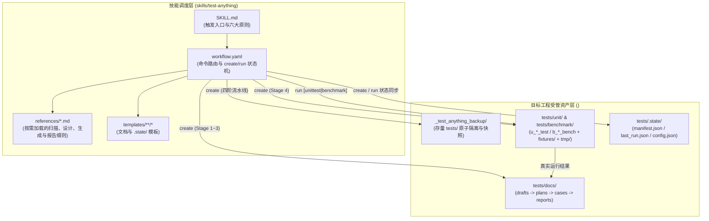

# test-anything 系统总体设计

> **created**: 2026-11-01 ｜ **last-change**: 2026-11-01 ｜ **status**: baseline

## 1. 简介

`test-anything` 是面向 AI Agent 与开发者的文档驱动全栈测试技能（Skill）。用户通过与 Agent 的需求讨论确立了技能的产品边界、目录拓扑与父子命令行为规范。

本设计定义 `test-anything` 的产品边界、父子命令路由模型、声明式技能包组成及跨模块核心约束。技能在目标工程中通过 `$test-anything` 父命令触发 `create` 与 `run` 子命令分支，围绕目标工程根目录下的 `tests/` 构建从文档功能点草稿（`drafts`）、测试计划（`plans`）、结构化用例规格（`cases`）到可执行单元测试（`unit`）与性能基准测试（`benchmark`）的生成与执行闭环。当前处于需求与设计基线定稿阶段，技能执行资源（`SKILL.md`、`workflow.yaml`、`references/`、`templates/`）尚未落地实现。

## 2. 索引

- 文档 ID：DESIGN-TA-OVERVIEW
- 对应主题：`TestAnythingOverview`
- 执行记录：[变更总账 (TestAnythingOverview)](../change/index.json#TestAnythingOverview)、[任务总账](../task/index.json)
- 研发路由：[研发索引](../index.json)、[设计模块矩阵](README.md)

| 设计文档 | 文档 ID | 对应主题 | 核心职责 |
|---|---|---|---|
| 本文（`00-系统总体设计.md`） | DESIGN-TA-OVERVIEW | `TestAnythingOverview` | 产品定位、命令路由解耦模型、技能包仓库拓扑与全局红线约束 |
| [目录结构与状态管理](01-目录结构与状态管理.md) | DESIGN-TA-LAYOUT | `TestLayoutAndState` | 目标工程 `tests/` 目录规范、`u_`/`b_` 英文命名、`.state/` 状态总账与 `_test_anything_backup/` 存量备份 |
| [测试用例生成流水线](02-测试用例生成流水线.md) | DESIGN-TA-CREATE | `TestCaseGeneration` | `create` 四阶段流水线（`drafts` → `plans` → `cases` → 代码）、文档功能点扫描、源码契约校准与存量测试融合 |
| [测试执行与报告引擎](03-测试执行与报告引擎.md) | DESIGN-TA-RUN | `TestExecutionAndReport` | `run [unittest\|benchmark]` 前置门禁、多语言运行器适配、`tests/tmp/` 隔离、源码只读原则与诚实报告生成 |

## 3. 规范

### 3.1 目标与非目标

- **核心目标**：
  1. 以文档功能点驱动测试用例设计，结合目标工程源码真实签名生成可编译运行的单元测试（`unit`）与基准测试（`benchmark`）；
  2. 统一目标工程 `tests/` 目录结构与 `u_` / `b_` 前缀命名规范，建立“文档功能点 ↔ 用例规格（`cases/`）↔ 测试代码（`unit/`、`benchmark/`）↔ 执行报告（`reports/`）”双向可追溯链路；
  3. 对已有测试的存量工程提供非破坏性的 `/_test_anything_backup/` 原子备份与测试逻辑融合机制；
  4. 严格解耦测试生成（`create`）与测试执行（`run`），确保执行结果与性能指标真实可信。
- **非目标**：
  1. 不引入外部独立工作流引擎、在线数据库或闭源运行服务，完全基于宿主 AI 工具链执行；
  2. 不在 `run` 阶段自动修改目标工程业务源码以“凑通过”；
  3. 暂不在 `tests/` 顶层拆分独立的 `integration/` 或 `e2e/` 目录（由 `unit/` 广义承载功能测试，公共数据统一置于 `fixtures/`）。

### 3.2 命令输入与路由契约

| 命令形式 | 前置条件 | 规定行为 | 失败/阻断条件 |
|---|---|---|---|
| `$test-anything`（裸调） | 目标工程根目录可写 | 初始化 `tests/` 目录骨架（若存在非受管 `tests/`，展示影响摘要并经用户明确确认后先备份至 `_test_anything_backup/`；上次 `create` 中断时续跑），并默认执行 `create` 全量生成 | 用户未确认迁移、manifest 损坏、备份路径冲突或目标目录无写权限时中止并报告 |
| `$test-anything help` / `--help` / `-h` | 无（纯只读） | 在会话中输出结构化中文帮助信息（命令语法、子命令说明、`create` 与 `run` 解耦规则、`tests/` 目录与 `u_`/`b_` 命名速查），**不创建或修改任何文件** | 无 |
| `$test-anything create` | 目标工程根目录可写 | 与裸调一致；**不设 `unittest \| benchmark` 子参数**，始终全量生成/增量更新单元测试与基准测试 | 既无项目文档也无源码/存量测试时停留在 `drafts/` 并报告缺失依据 |
| `$test-anything run` | 已完成 `create`（`tests/.state/manifest.json` 记录 `create_status: complete`） | 依次执行 `tests/unit/` 与 `tests/benchmark/` 全部测试，输出 `u_`、`b_` 与 `all_` 汇总报告 | **未执行过 `create` 时直接报错中止**，提示先运行 `$test-anything create`，严禁自动触发 `create` |
| `$test-anything run unittest` | 已执行过 `create` 且存在单测代码 | 仅执行 `tests/unit/` 下的单元测试，输出 `u_` 单元测试报告并更新 `.state/last_run.json` | 未执行过 `create` 时直接报错中止 |
| `$test-anything run benchmark` | 已执行过 `create` 且存在基准测试代码 | 仅执行 `tests/benchmark/` 下的基准测试，输出 `b_` 性能基准报告并更新 `.state/last_run.json` | 未执行过 `create` 时直接报错中止 |

## 4. 设计详情

### 4.1 架构与行为

`test-anything` 采用与 `knowledge-map`、`ad-flow` 一致的声明式技能架构，分为**技能调度层**（本仓库）与**目标工程受管资产层**（目标项目 `tests/` 与 `_test_anything_backup/`）：

### 4.2 核心业务规则

<!-- @topic: TestAnythingOverview -->

1. **单入口多子命令解耦规则**：
   - 父命令 `$test-anything` 统一收敛技能调用入口；裸调等同于初始化 `tests/` 并执行 `create`；
   - `help`（含 `--help`、`-h` 及子命令 `--help`）为纯只读帮助分支：仅在对话中展示命令用法、四阶段流水线与 `tests/` 目录规范，严禁触发目录初始化、备份或测试执行；
   - `create` 与 `run` 职责边界严格正交：`create` 只负责扫描、规划、生成测试文档与测试代码（不作为常规测试运行报告入口），且 `create` 不拆分 `unittest` 或 `benchmark` 子命令，始终保证单测与基准测试规格同步生成；`run` 只负责执行已生成的测试并产出报告，遇到未初始化或未生成用例的工程立即报错返回，不隐式越权执行 `create`。
2. **证据追溯与诚实报告规则**：
   - 生成的每一条测试用例（`UT-xxx` / `BM-xxx`）必须关联明确的项目文档功能点或存量测试来源，并校准目标源码的真实函数签名与模块路径；对于文档已声明但源码未实现的能力，在 `cases/` 中标记为 `unimplemented/todo`，不生成伪造通过的测试代码。
   - `run` 阶段必须调用宿主环境的真实测试运行器，如实记录退出码、通过/失败计数、错误堆栈与基准耗时，严禁修改目标项目业务源码来掩盖测试失败。
3. **技能包自身仓库结构契约**：
   - `SKILL.md`：声明技能名 `test-anything`、触发条件、全局原则与规则归属路由表；
   - `workflow.yaml`：使用英文定义命令解析路由、`create` 四阶段状态机与 `run` 三分支执行流程；
   - `references/`：拆分为 `state-and-backup.md`、`doc-scanning.md`、`case-and-plan-design.md`、`codegen-adapters.md`、`runner-and-reporting.md` 五个按需加载参考文件，每条规则只在一个参考文件中完整表述；
   - `templates/`：提供 `backup-README.md.tpl`、`docs/` 下 9 份 Markdown 模板（`README`、`draft`、`test_plan`、`module_plan`、`u_cases`、`b_cases`、`u_report`、`b_report`、`all_report`）及 `state/` 下 3 份 JSON 模板。

### 4.3 验证与实现情况

- **设计依据**：已由用户在需求讨论与格式规范评审中明确确认，现行设计状态置为 `baseline`。
- **当前实现状态**：
  - 已完成：`ad-flow` 治理骨架与本组现行设计基线（`00`～`03`）；
  - 待交付（后续通过 `docs/devel/task/` 拆解 T 卡实施）：`SKILL.md`、`workflow.yaml`、`references/` 下 5 份规则手册、`templates/` 下 13 份标准模板及技能自身回归验证样例。

### 4.4 规则演进

| 编号 | 类型 | 简介 | 规则演进 |
|---|---|---|---|
| — | 设计确认 | 初始设计基线建立 | 整合会话确认的父子命令路由、`tests/` 拓扑、`create` 四阶段与 `run` 诚实报告规则 |
| [C001](../change/C001.json) | 缺陷修复 | 路由前提收紧 | 裸调/`create` 迁移存量 `tests/` 前须经用户明确确认并支持中断续跑；`run` 仅在 `create_status: complete` 时放行 |

### 4.5 参考资料

- 用户会话确认的需求决策：`$test-anything` 父子命令路由（`create` 与 `run [unittest|benchmark]` 严格解耦）、无外部引擎声明式技能架构（`SKILL.md` + `workflow.yaml` + `references/` + `templates/`）。
- 现行模块设计：[目录结构与状态管理](01-目录结构与状态管理.md)、[测试用例生成流水线](02-测试用例生成流水线.md)、[测试执行与报告引擎](03-测试执行与报告引擎.md)。
