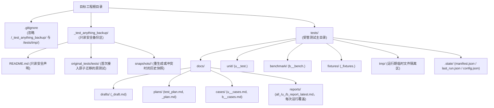

# 目录结构与状态管理 设计方案

> **created**: 2026-11-01 ｜ **last-change**: 2026-11-01 ｜ **status**: baseline

## 1. 简介

本模块定义 `test-anything` 在目标工程根目录下生成的 `tests/` 标准目录拓扑、全英文及 `u_` / `b_` 前缀文件命名契约、`tests/.state/` 状态追踪协议，以及针对已有存量测试工程的 `/_test_anything_backup/` 安全备份隔离机制。

## 2. 索引

- 文档 ID：DESIGN-TA-LAYOUT
- 所属总体：[系统总体设计](00-系统总体设计.md)
- 对应主题：`TestLayoutAndState`
- 执行记录：[变更总账 (TestLayoutAndState)](../change/index.json#TestLayoutAndState)

## 3. 规范

### 3.1 目标工程目录契约

1. **顶层目录构成（`<target_root>/tests/`）**：
   - `tests/docs/`：测试文档中心，下设 `README.md`、`drafts/`、`plans/`、`cases/`、`reports/` 四个子目录；
   - `tests/unit/`：可执行单元测试代码目录；
   - `tests/benchmark/`：可执行性能基准测试代码目录；
   - `tests/fixtures/`：跨测试复用的公共夹具、Mock 数据与黄金样本目录；
   - `tests/tmp/`：测试编译产物、运行期沙箱与覆盖率/基准原始转储的临时目录（必须被 `.gitignore` 忽略）；
   - `tests/.state/`：受管状态与追踪元数据目录，包含 `manifest.json`、`last_run.json` 与可选 `config.json`。
2. **文件命名与前缀契约**：
   - `tests/docs/` 及代码目录全部采用英文标识命名（`snake_case`）；
   - `cases/` 与 `reports/` 不再拆分 `unit/`、`benchmark/` 子目录，统一通过文件名前缀 **`u_`**（单元测试）与 **`b_`**（基准测试）区分类型；
   - 汇总报告使用 `all_` 前缀（如 `all_report_latest.md`）。
3. **存量测试备份与 `.gitignore` 契约**：
   - 创建任何备份或初始化 `tests/tmp/` 前，必须确保目标工程根 `.gitignore` 生效忽略 `/_test_anything_backup/` 与 `/tests/tmp/`；
   - 若目标工程已存在非本技能管理的 `tests/`（即不存在有效的 `tests/.state/manifest.json`），必须先将原 `tests/` 原子移动至 `_test_anything_backup/original_tests/tests/`，绝不在原目录直接混写或删除文件。

## 4. 设计详情

### 4.1 架构与行为

目标工程受管目录与备份区的流转及隔离关系如下：

### 4.2 核心业务规则

<!-- @topic: TestLayoutAndState -->

1. **`tests/docs/` 四子目录与文件命名规则**：
   - `docs/README.md`：测试文档总导航，提供模块列表、用例统计与最新报告链接；
   - `docs/drafts/`：存放 `<module>_draft.md`（及按需细分的 `u_<module>_draft.md`、`b_<module>_draft.md`），作为 `create` 扫描文档的第一落点；
   - `docs/plans/`：存放全局 `test_plan.md` 与分模块 `<module>_plan.md`，定义测试框架选型、运行命令及“功能点 ↔ 用例 ID ↔ 源码路径”追溯矩阵；
   - `docs/cases/`：存放 `u_<module>_cases.md` 与 `b_<module>_cases.md`，记录结构化用例规格；
   - `docs/reports/`：仅存放 `all_report_latest.md`、`u_report_latest.md`、`b_report_latest.md` 三份最新报告，每次运行原地覆盖，不保留按运行批次命名的历史报告。
2. **`tests/.state/` 状态协议规则**：
   - `manifest.json`：包含 `schema_version`、`skill_version`、`create_status`（`in_progress` / `complete`）、`completed_stage`（`0`–`4`）、`created_at`、`updated_at`、`stack`（语言及单测/基准运行命令）、`backup_ref`、`sources`（源文档与源码 SHA-256）及 `modules`（每个模块的 draft/plan/cases/code 路径、SHA-256 与 `case_ids` 列表）。`create_status: complete`（或缺省该字段的旧 manifest）是判定工程已完成 `create` 的唯一权威依据；
   - **续跑进度记录**：Stage 0 结束即写入 `create_status: in_progress`，此后每个阶段对全部在范围模块完成后将 `completed_stage` 置为该阶段号，Stage 4 完成后置 `create_status: complete`、`completed_stage: 4`；受阻或中断的阶段不推进 `completed_stage`，下次 `create` 从 `completed_stage + 1` 续跑；
   - `last_run.json`：包含 `run_id`、`scope`（`all` / `unittest` / `benchmark`）、`executed_at`、`unit` 与 `benchmark` 各自的状态（单测 `passed` / `failed` / `error` / `not_run`，基准 `completed` / `failed` / `error` / `not_run`）、命令、退出码、用例统计、耗时及报告路径；
   - `config.json`：可选文件，允许用户自定义测试运行命令、排除目录与性能阈值，增量更新时原样保留用户配置。
3. **`/_test_anything_backup/` 安全备份与防冲突规则**：
   - **写入前先只读判定模式**：无 `tests/` 为全新初始化；`manifest.json` 有效且 `create_status: in_progress` 为续跑（不备份、不迁移）；`create_status: complete` 或缺省为增量；`manifest.json` 存在但无法解析或 `schema_version` 无效时停止并报告，绝不按存量目录迁移；有 `tests/` 无 `manifest.json` 才判为非受管存量目录；
   - **存量迁移须人工明确确认**：迁移前只读盘点并向用户展示影响摘要（文件数、Git 已跟踪文件数及“迁入被忽略的备份区后在 Git 视角等同删除”的后果、引用 `tests/` 的项目配置与 CI 文件、备份目标路径），取得用户在会话中的明确确认后才写 `.gitignore`、备份 README 并原子迁移；调用命令本身、既往指令或沉默均不视为确认，未确认时零写入停止；
   - 对齐 `ad-flow` 备份规范：移动前先检查目标快照路径是否已存在，若存在冲突则停止操作并报告，严禁覆盖已捕获的原始备份；
   - 当增量 `create` 检测到 `tests/unit/` 或 `tests/benchmark/` 下的受管文件哈希与 `manifest.json` 不一致（即用户做过手工修改）时，更新前必须先将该文件复制到 `_test_anything_backup/snapshots/<run_id>/` 保存快照；
   - AI Agent 严禁删除、清空或移动 `/_test_anything_backup/` 中的任何已捕获快照。

4. **通用页眉元数据与正文语言规则**：
   - `tests/docs/` 下所有 Markdown 文件保持英文文件名与**中文正文**（代码标识符、函数签名、文件路径、命令、功能点编号 `FP-<module>-<NN>` 与用例 ID `UT-<module>-<NNN>` / `BM-<module>-<NNN>` 保持英文原样）；
   - 每篇文档 H1 标题下方固定使用单行引用块记录元数据（不添加 YAML frontmatter）：
     `> **module**: <module|global> ｜ **type**: <doc_type> ｜ **updated_at**: YYYY-MM-DD ｜ **status**: <draft|active|passed|failed|completed|error>`。
5. **测试文档总导航格式规则（`tests/docs/README.md`）**：
   - 固定包含三节：`## 1. 测试体系概览与快速入口`（受管版本、技术栈运行器、全量/单测/基准执行命令）、`## 2. 模块测试资产矩阵`（表格列：模块、`drafts/`、`plans/`、`cases/u_*`、`cases/b_*`、单测数/基准数、最新运行状态）、`## 3. 全局计划与最新报告导航`（链接至 `plans/test_plan.md` 及 `reports/` 下三份 `*_latest.md`）。
6. **公共数据夹具格式规则（`tests/fixtures/`）**：
   - JSON/YAML 夹具文件顶部固定包含 `_meta` 对象（记录 `managed_by: "test-anything"`、`module` 及引用的用例列表 `used_by_cases`），其后按语义键名存放测试样本数据。

### 4.3 验证与实现情况

- **判定条件**：检查 `templates/` 下的目录、Markdown 页眉与 JSON 状态模板是否完整覆盖上述路径与字段，且 `workflow.yaml` 中的初始化与备份步骤严格遵循 `.gitignore` 先行与原子移动规则。
- **当前状态**：现行设计基线已定稿（`baseline`），对应模板与规则文档待后续 T 卡实现。

### 4.4 规则演进

| 编号 | 类型 | 简介 | 规则演进 |
|---|---|---|---|
| — | 设计确认 | 初始设计建立与格式定稿 | 确立 `tests/{docs,unit,benchmark,fixtures,tmp,.state}`、`u_`/`b_` 前缀、通用单行元数据页眉、`docs/README.md` 三节导航、`fixtures` `_meta` 契约与 `_test_anything_backup/` 机制 |
| [C001](../change/C001.json) | 缺陷修复 | create 续跑、存量迁移确认与运行异常状态 | `manifest.json` 新增 `create_status` / `completed_stage` 并自 Stage 0 起写入以支持续跑；写入前只读判定模式，损坏的 manifest 停止而非迁移；存量 `tests/` 迁移须展示影响摘要并取得明确确认；状态取值新增 `error` |
| [C002](../change/C002.json) | 体验微调 | 报告仅保留最近一次运行 | `reports/` 只保留三份 `*_latest.md` 并原地覆盖，取消 `u_/b_report_<run_id>.md` 批次报告 |

### 4.5 参考资料

- 用户会话确认的目录与命名决策：顶层采用 `docs/`、`unit/`、`benchmark/`、`fixtures/`、`tmp/`、`.state/`；`docs/` 下设 `drafts/`、`plans/`、`cases/`、`reports/`，全部使用英文命名并以 `u_`、`b_` 前缀区分单测与基准测试；存量测试采用 `/_test_anything_backup/` 原子隔离备份。
- 所属总体设计：[系统总体设计](00-系统总体设计.md)。
