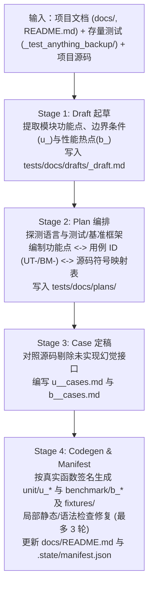

# 测试用例生成流水线 设计方案

> **created**: 2026-11-01 ｜ **last-change**: 2026-11-01 ｜ **status**: baseline

## 1. 简介

本模块定义 `$test-anything`（裸调默认）与 `$test-anything create` 子命令的核心生成机制：如何通过扫描目标项目文档中的业务功能点、结合存量测试资产与目标工程源码调用契约，按四阶段流水线（`drafts` → `plans` → `cases` → `unit` & `benchmark`）生成完整的测试文档与可执行测试代码。

## 2. 索引

- 文档 ID：DESIGN-TA-CREATE
- 所属总体：[系统总体设计](00-系统总体设计.md)
- 对应主题：`TestCaseGeneration`
- 执行记录：[变更总账 (TestCaseGeneration)](../change/index.json#TestCaseGeneration)

## 3. 规范

### 3.1 输入与输出契约

- **输入来源**：
  1. 目标工程文档：`docs/`（优先识别 `docs/official/` 等结构化设计文档）、根目录 `README.md`、OpenAPI/Proto/Schema 等接口定义；
  2. 存量测试备份：`_test_anything_backup/original_tests/`（当首次接管已有测试的项目时存在）；
  3. 目标工程源码与构建清单：`src/`、`lib/`、`app/`、`cmd/`、`package.json`、`pyproject.toml`、`go.mod`、`Cargo.toml` 等，用于探测语言框架并校准真实函数签名与导入路径。
- **阶段交付顺序（不可跳步）**：
  1. **Stage 0 (`INIT_AND_BACKUP`)**：确保 `.gitignore`、处理存量测试备份、初始化 `tests/` 目录骨架；
  2. **Stage 1 (`DRAFT`)**：提取功能点与候选测试点，率先落盘 `tests/docs/drafts/<module>_draft.md`；
  3. **Stage 2 (`PLAN`)**：确定测试框架与运行器命令，生成 `tests/docs/plans/test_plan.md` 与 `<module>_plan.md`；
  4. **Stage 3 (`CASE`)**：核对源码实现状态，生成正式规格 `tests/docs/cases/u_<module>_cases.md` 与 `b_<module>_cases.md`；
  5. **Stage 4 (`CODEGEN_AND_MANIFEST`)**：生成 `tests/unit/u_<module>_test.<ext>`、`tests/benchmark/b_<module>_bench.<ext>`、`tests/fixtures/`，并写入 `tests/docs/README.md` 与 `tests/.state/manifest.json`。

### 3.2 边界与失败条件

- `create` 不设 `unittest` 或 `benchmark` 过滤子命令，每次执行均同步覆盖单元测试与性能基准测试的设计与生成；
- 若目标项目既无可用文档也无源码/存量测试，流水线在 Stage 1 停留在 `drafts/` 并如实报告缺失来源；
- 任一阶段受阻或中断时，`tests/.state/manifest.json` 保持 `create_status: in_progress` 且 `completed_stage` 不推进；下次 `create` 识别为续跑，从 `completed_stage + 1` 继续，不得把本技能自己的半成品当作存量 `tests/` 迁移；
- 若文档中描述的某项功能在源码中尚未实现，必须在 `cases/` 中标注 `status: unimplemented/todo`，严禁针对不存在的函数生成虚假通过的测试代码。

## 4. 设计详情

### 4.1 架构与行为

`create` 四阶段生成与增量刷新状态流转如下：

### 4.2 核心业务规则

<!-- @topic: TestCaseGeneration -->

1. **文档驱动功能点提取与草稿格式规则（Stage 1 `DRAFT`）**：
   - 按业务模块拆分草稿文件 `tests/docs/drafts/<module>_draft.md`，采用**四节结构化草稿**：
     1. `## 1. 来源与模块边界`：列出源文档路径、目标源码路径、存量测试备份路径与模块职责边界；
     2. `## 2. 功能点拆解清单 (Functional Points)`：表格记录 `功能点 ID (FP-<module>-<NN>)`、`功能名称`、`触发与输入约束`、`预期行为与输出`、`边界与异常规则`、`来源定位`；
     3. `## 3. 候选测试点分流`：分为 `### 3.1 单元测试候选 (u_)`（含 `normal` / `boundary` / `exception` 场景维度）与 `### 3.2 性能基准候选 (b_)`（含性能热点原因、计划负载规模与关注指标）；
     4. `## 4. 待确认与实现差异 (Gaps)`：记录文档已声明但源码未实现（`unimplemented`）、契约冲突或缺失数据的挂起项。
   - 若存在 `_test_anything_backup/original_tests/`，盘点原测试已覆盖的场景、断言与夹具，一并合入草稿并注明来源。
2. **两级测试计划与双向追溯矩阵规则（Stage 2 `PLAN`）**：
   - 采用**“全局总计划 + 模块计划”两级结构**：
     - `tests/docs/plans/test_plan.md`：包含目标技术栈与单测/基准运行命令（强制将缓存与临时目录指向 `tests/tmp/`）、模块测试覆盖总表、全局夹具与外部依赖隔离策略；
     - `tests/docs/plans/<module>_plan.md`：包含核心的**“功能点 ID (`FP-xxx`) ↔ 用例 ID (`UT-<module>-<NNN>` / `BM-<module>-<NNN>`) ↔ 类型 (`u_`/`b_`) ↔ 场景/负载分类 ↔ 目标源码文件与函数签名 ↔ 对应测试代码位置 ↔ 优先级 ↔ 状态”双向追溯矩阵表**，以及本模块的数据夹具与 Mock 边界策略。
3. **正式用例规格文档格式规则（Stage 3 `CASE`）**：
   - `cases/u_<module>_cases.md` 与 `cases/b_<module>_cases.md` 均采用**“顶部用例汇总表 + 逐条 H3 结构化卡片”**排版：
     - **单元测试规格（`u_<module>_cases.md`）**：文首为 `## 1. 单元测试用例总表`；`## 2. 用例规格详情` 下每条用例以 `### UT-<module>-<NNN>: <用例标题>` 展开，固定包含 **6 项要素**：① 关联功能点、② 目标符号（源码路径与函数签名）、③ 场景类型（`normal` / `boundary` / `exception`）、④ 前置条件与夹具、⑤ 输入参数（Given / When）、⑥ 预期结果与断言（Then）。
     - **基准测试规格（`b_<module>_cases.md`）**：文首为 `## 1. 基准测试用例总表`；`## 2. 基准规格详情` 下每条用例以 `### BM-<module>-<NNN>: <基准名称>` 展开，固定包含 **5 项要素**：① 关联功能点与热点说明、② 目标符号、③ 负载规模（Workload）、④ 预热与迭代策略、⑤ 采集指标与基线阈值。
4. **可执行测试代码格式与源码校准规则（Stage 4 `CODEGEN`）**：
   - 生成 `tests/unit/u_<module>_test.<ext>` 与 `tests/benchmark/b_<module>_bench.<ext>` 时，必须读取目标源码确认模块导入路径、函数签名、参数类型与返回值结构；
   - **代码内部结构规范**：
     1. **文件头元数据注释**：声明 `@managed-by: test-anything`、`@module: <module>`、`@type: unit_test|benchmark`、`@cases_doc: tests/docs/cases/...`；
     2. **函数级追溯锚点注释**：每个测试/基准函数上方固定标注 `@case: UT-<module>-<NNN>`（或 `BM-<module>-<NNN>`）、`@feature: FP-<module>-<NN>`，供 `run` 阶段将运行结果精确映射回用例 ID；
     3. **函数命名与 AAA 结构**：测试函数命名兼容目标语言运行器发现规则并内嵌用例编号（如 `test_ut_<module>_001_<slug>`、`TestUT_<Module>_001_<Slug>`、`BenchmarkBM_<Module>_001_<Slug>`）；函数体遵循 `Arrange -> Act -> Assert` 结构，复杂输入从 `tests/fixtures/` 读取，临时写操作指向 `tests/tmp/`；
   - 代码生成后可执行语法检查或编译预检，若因测试代码自身的导入或语法问题失败，允许在 Stage 4 内局部修复生成的测试文件（最多 3 轮），严禁修改目标项目业务源码。
5. **增量刷新与冲突保护规则**：
   - 再次运行 `create` 时，通过 `tests/.state/manifest.json` 比对源文档与源码的 SHA-256 哈希，仅重算发生变更的模块；
   - 若受管测试代码文件被人类开发者手动修改过（磁盘文件 SHA-256 与 `manifest.json` 不符），先备份至 `_test_anything_backup/snapshots/<run_id>/`，并在更新时保留人工新增用例或报告冲突。

### 4.3 验证与实现情况

- **判定条件**：`workflow.yaml` 完整定义 Stage 0–4 的输入、产物与失败回退；`references/doc-scanning.md`、`references/case-and-plan-design.md`、`references/codegen-adapters.md` 与 `templates/docs/` 模板完整覆盖上述章节与字段格式。
- **当前状态**：现行设计基线已定稿（`baseline`），待后续 T 卡实现具体参考手册与模板文件。

### 4.4 规则演进

| 编号 | 类型 | 简介 | 规则演进 |
|---|---|---|---|
| — | 设计确认 | 初始设计建立与格式定稿 | 确立草稿四节结构、两级测试计划追溯矩阵、`cases/` 汇总表加 H3 卡片格式，以及测试代码 `@case`/`@feature` 锚点与 AAA 规范 |
| [C001](../change/C001.json) | 缺陷修复 | create 中断续跑 | 四阶段按 `completed_stage` 记录进度，受阻或中断后由下次 `create` 续跑，替代原“仅保留 `drafts/`”的不可续跑表述 |

### 4.5 参考资料

- 用户会话确认的生成流水线决策：`create` 先产出 `drafts/` 草稿，在单次调用内按 `drafts/` → `plans/` → `cases/` → `unit/` & `benchmark/` 四阶段推进；采用“文档驱动功能点 + 源码校准调用契约 + 存量测试融合”策略。
- 关联设计：[系统总体设计](00-系统总体设计.md)、[目录结构与状态管理](01-目录结构与状态管理.md)。
