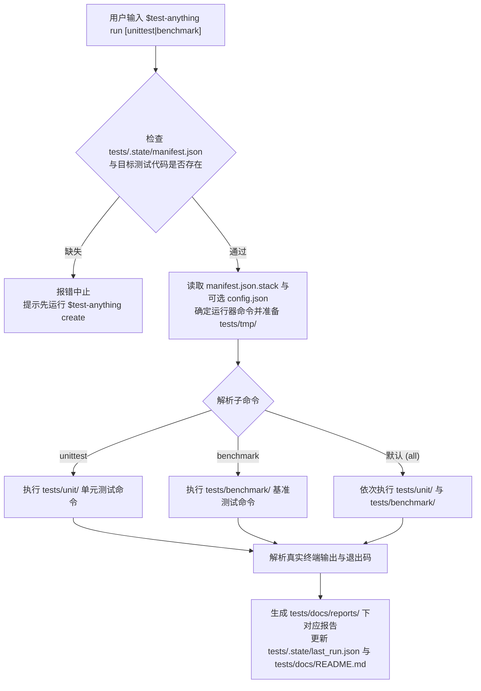

# 测试执行与报告引擎 设计方案

> **created**: 2026-11-01 ｜ **last-change**: 2026-11-01 ｜ **status**: baseline

## 1. 简介

本模块定义 `$test-anything run`（默认全量）及其子命令 `$test-anything run unittest`、`$test-anything run benchmark` 的前置门禁校验、多语言测试运行器调度、`tests/tmp/` 运行时隔离、业务源码只读红线，以及 `tests/docs/reports/` 与 `tests/.state/last_run.json` 的报告生成规范。

## 2. 索引

- 文档 ID：DESIGN-TA-RUN
- 所属总体：[系统总体设计](00-系统总体设计.md)
- 对应主题：`TestExecutionAndReport`
- 执行记录：[变更总账 (TestExecutionAndReport)](../change/index.json#TestExecutionAndReport)

## 3. 规范

### 3.1 执行范围与门禁契约

| 子命令 | 执行目标目录 | 报告输出（`tests/docs/reports/`） | 状态更新（`tests/.state/`） |
|---|---|---|---|
| `$test-anything run` | `tests/unit/` + `tests/benchmark/` | `u_report_latest.md`、`b_report_latest.md`、`all_report_latest.md`（原地覆盖） | 更新 `last_run.json`（`scope: "all"`） |
| `$test-anything run unittest` | 仅 `tests/unit/` | `u_report_latest.md`（原地覆盖） | 更新 `last_run.json`（`scope: "unittest"`） |
| `$test-anything run benchmark` | 仅 `tests/benchmark/` | `b_report_latest.md`（原地覆盖） | 更新 `last_run.json`（`scope: "benchmark"`） |

- **严格解耦前置门禁**：执行任何 `run` 命令前，必须先检查 `tests/.state/manifest.json` 是否存在、记录 `create_status: complete`（缺省视为完成），且所选范围内已有生成的测试代码文件；`create_status: in_progress` 时报错并提示重新执行 `create` 续跑。若不存在，立即报错退出并提示用户先执行 `$test-anything` 或 `$test-anything create`，**严禁在 `run` 中自动触发 `create`**。

### 3.2 运行隔离与诚实性约束

1. **临时文件强制隔离**：所有运行期缓存（如 `.pytest_cache`、编译二进制、覆盖率原始文件、临时数据库/沙箱文件）一律定向输出至 `tests/tmp/`，严禁污染项目根目录或源码目录。
2. **业务源码只读红线**：`run` 阶段对目标工程业务源码保持 100% 只读；遇到测试失败或性能退化时，严禁修改业务源码、弱化测试断言或删除失败用例以伪造通过。
3. **真实证据记录**：报告中的所有统计数字、耗时、吞吐量与错误堆栈必须来自本次真实命令输出；未执行的范围标记为 `not_run`，未测得的数值写 `n/a` 而非模板占位 `0`。
4. **状态确定性判定**：按顺序取首个命中项——范围外为 `not_run`；退出码非 0 但未解析出失败用例（崩溃、收集/导入错误、用法错误、超时）、未实际执行任何用例（未收集或全部跳过）、计数无法解析，或退出码为 0 却解析出失败，均判 `error`；存在失败用例判 `failed`；仅当退出码为 0、无失败且至少 1 条用例实际通过（基准为至少 1 条产出指标）时判 `passed`（基准为 `completed`）。全量报告取最差轨状态（`error` > `failed` > `passed`）。
5. **仅保留最近一次结果**：每份报告只有一个 `*_latest.md` 文件并在每次运行时原地覆盖，不生成按 `run_id` 命名的历史报告，页眉中的 `run_id` 标识所属运行；基准 `Δ%` 读取 `last_run.json` 中的上次指标，不依赖历史报告。`tests/docs/reports/` 中残留的旧版本批次报告（`u_/b_report_<YYYYMMDD_HHMMSS>.md`）仅在运行小结中提议清理，经用户明确确认后才删除。

## 4. 设计详情

### 4.1 架构与行为

`run` 子命令的门禁核验、分流执行与报告沉淀流程如下：

### 4.2 核心业务规则

<!-- @topic: TestExecutionAndReport -->

1. **多语言运行器适配规则**：
   - 优先使用 `tests/.state/config.json`（若用户配置）或 `tests/.state/manifest.json` 中 `stack.unit_runner` / `stack.benchmark_runner` 登记的命令；
   - 默认适配主流技术栈标准运行器（Python `pytest`/`unittest`、Go `go test` / `go test -bench`、Node/TS `vitest`/`jest`/`node --test`、Rust `cargo test`/`cargo bench` 等），并通过命令行参数或环境变量将临时工作区与缓存指向 `tests/tmp/`。
2. **单元测试报告结构化三段式格式规则（`u_report_*.md`）**：
   - 页眉：`> **module**: global ｜ **type**: unit_report ｜ **run_id**: <run_id> ｜ **updated_at**: YYYY-MM-DD ｜ **status**: passed|failed|error`；
   - `## 1. 执行概览`：列出执行命令、退出码、执行时间与总耗时，以及统计表（总用例数、通过、失败、跳过、通过率）；
   - `## 2. 模块与用例执行明细`：按表格列出每条 `UT-<module>-<NNN>` 的所属模块、场景类型、绑定测试函数、执行状态（`PASS` / `FAIL` / `SKIP`）与耗时（ms）；
   - `## 3. 失败与异常诊断`：仅当状态为 `passed` 时注明“本次运行全部通过，无失败用例”；状态为 `error` 时写 `### 运行器异常 (error)` 小节（退出码、原始输出尾部摘录、疑似原因与复现命令），严禁写“全部通过”；有失败时按 `### UT-xxx` 逐条列出关联 `cases/u_<module>_cases.md` 路径、目标源码位置、失败断言摘要、真实错误堆栈代码块与单跑复现命令。
3. **性能基准报告结构化三段式格式规则（`b_report_*.md`）**：
   - 页眉：`> **module**: global ｜ **type**: benchmark_report ｜ **run_id**: <run_id> ｜ **updated_at**: YYYY-MM-DD ｜ **status**: completed|failed|error`；
   - `## 1. 运行环境与执行概览`：记录软硬件与语言运行时版本、执行命令、退出码与总耗时；
   - `## 2. 性能基准核心指标表`：按表格列出每条 `BM-<module>-<NNN>` 的所属模块、负载规模、采样轮次、平均耗时、P99 延迟、吞吐量（`ops/sec`）、内存分配（`B/op`）及与上次 `last_run.json` 对比的变化率（`Δ%`）；
   - `## 3. 热点分析与基线对比`：说明显著性能波动或超过阈值（如退化 >15%）的关注项。
4. **全量综合报告三段式格式规则（`all_report_latest.md`）**：
   - 页眉：`> **module**: global ｜ **type**: all_report ｜ **run_id**: <run_id> ｜ **updated_at**: YYYY-MM-DD ｜ **status**: passed|failed|error`；
   - `## 1. 双轨执行总览`：汇总 `unittest` 与 `benchmark` 两轨的状态、退出码、用例统计、耗时及分项报告链接；
   - `## 2. 模块健康度矩阵`：按模块汇总单测通过率、基准核心吞吐、待补差异项（`Gaps`）与综合健康度评估；
   - `## 3. 本次运行信息`：记录 `run_id`、执行时间、运行范围、两轨实际执行命令与状态文件 `tests/.state/last_run.json`。

### 4.3 验证与实现情况

- **判定条件**：`workflow.yaml` 的 `run` 分支包含 `manifest.json` 前置断言、`unittest`/`benchmark`/`all` 三路路由，且 `references/runner-and-reporting.md` 与 `templates/docs/*_report.md.tpl`、`templates/state/last_run.json.tpl` 字段一致。
- **当前状态**：现行设计基线已定稿（`baseline`），待后续 T 卡实现。

### 4.4 规则演进

| 编号 | 类型 | 简介 | 规则演进 |
|---|---|---|---|
| — | 设计确认 | 初始设计建立与报告格式定稿 | 确立 `run [unittest\|benchmark]` 严格解耦门禁、`tests/tmp/` 隔离，以及 `u_`、`b_`、`all_` 结构化三段式测试报告规范 |
| [C001](../change/C001.json) | 缺陷修复 | 运行异常不得误报通过 | 新增 `error` 状态与确定性判定顺序，`u_report` 第 3 节按状态渲染；门禁拒绝 `create_status: in_progress` 的未完成 manifest |
| [C002](../change/C002.json) | 体验微调 | 报告仅保留最近一次运行 | 取消 `u_/b_report_<run_id>.md` 批次报告，三份 `*_latest.md` 原地覆盖；`all_report` 第 3 节由批次归档索引改为本次运行信息；旧批次报告经确认后清理 |

### 4.5 参考资料

- 用户会话确认的执行与报告决策：`run` 与 `create` 严格解耦（未 `create` 直接报错中止），支持默认全量、`unittest`、`benchmark` 三种运行范围，运行期临时文件隔离至 `tests/tmp/`，严禁篡改目标业务源码凑通过，如实产出 `u_`、`b_`、`all_` 报告与 `last_run.json`。
- 关联设计：[系统总体设计](00-系统总体设计.md)、[目录结构与状态管理](01-目录结构与状态管理.md)。
