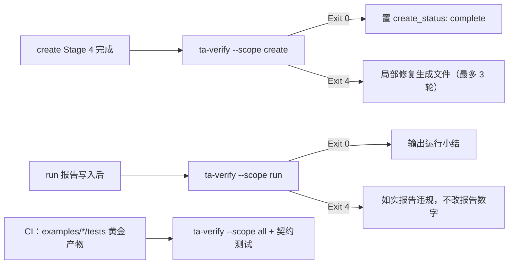

# 产物校验与样例回归 设计方案

> **created**: 2026-11-23 ｜ **last-change**: 2026-11-24 ｜ **status**: draft

## 1. 简介

本模块为 `test-anything` 增加确定性的产物校验器 `ta-verify`，用于核对 `create` / `run` 在目标工程 `tests/` 下产出的目录、命名、追溯锚点与状态文件是否符合 01～03 的现行规则，并以 Python、Go 两个样例工程的黄金产物和最小 CI 构成技能自身的回归基线。

## 2. 索引

- 文档 ID：DESIGN-TA-VERIFY
- 所属总体：[系统总体设计](00-系统总体设计.md)
- 对应主题：`ArtifactVerification`
- 执行记录：[任务总账 (ArtifactVerification)](../task/index.json)、[T02](../task/T02.json)

## 3. 规范

### 3.1 输入与输出契约

- **调用形式**：`scripts/ta-verify --target <目标工程根目录> [--scope create|run|all] [--json]`，在技能包内运行，不安装、不复制到目标工程；只读目标工程，不写任何文件。另提供 `--receipt`，按 `adflow-verify --receipt` 的固定格式输出本次产物校验的回执；它只汇报 `ta-verify` 自身的校验结果，不作为 `run` 结束后的对话回执。
- **实现约束**：单文件 Python 3 脚本，仅依赖标准库，确定性、无网络访问，退出码与诊断码风格参照 `adflow-verify`。本能力使技能包首次包含可执行脚本，交付时同步修订 [系统总体设计](00-系统总体设计.md) 的非目标与技能包结构契约。
- **退出码**：`0` 全部通过；`4` 存在确定性违规；`2` 用法错误或目标不可读。`--json` 输出 `summary.codes` 与带 `path`、`hint` 的 `findings[]`。
- **样例工程**：技能包内 `examples/python-sample/`、`examples/go-sample/` 各含最小业务源码、文档与一份提交入库的 `tests/` 黄金产物（由 `create`/`run` 实际生成后人工审定）。
- **负向样例**：`examples/negative/` 下提供故意违规的最小产物（缺 `@case` 锚点、manifest 字段缺失或结构非法、`u_`/`b_` 前缀错误、孤立用例），各对应一个预期诊断码；manifest 哈希与磁盘不符作为警告样例单独断言 Exit 0 且出现对应警告码。

### 3.2 边界与失败条件

- `ta-verify` 只校验结构与追溯一致性，不判断用例设计质量，也不代替 `run` 的真实测试执行；
- CI 不调用 AI 执行 `create`/`run`，只对提交入库的黄金样本与负向样例运行 `ta-verify`，并执行技能包契约测试；
- 样例比对只核对结构与追溯关系，不比对生成文本的逐字内容；
- 覆盖率数据的解析不属于本模块，由 [测试执行与报告引擎](03-测试执行与报告引擎.md) 规则 5 作为 `ta-verify` 扩展另行交付；
- 发现违规时不自动修复目标工程文件，修复由 `create`/`run` 自身的生成—检查—修复循环完成。

## 4. 设计详情

### 4.1 架构与行为

### 4.2 核心业务规则

<!-- @topic: ArtifactVerification -->

1. **规则溯源**：每个诊断码在脚本内登记其依据的 `references/` 条款（文件与小节）；契约测试核对登记的条款在 `references/` 中仍存在，防止规则与校验器漂移。
2. **校验项（`--scope create`）**：`tests/` 顶层六目录齐全；`docs/` 四子目录与 `u_`/`b_`/`all_` 命名合规；每个 `cases/` 中的 `UT-`/`BM-` 用例在 plans 追溯矩阵中出现且绑定 `FP-` 功能点；每个测试函数的 `@case`/`@feature` 锚点能回指 `cases/` 中存在的用例；`manifest.json` 字段与 01 协议一致，`modules[].case_ids` 与 cases 文档一致，受管文件 SHA-256 与磁盘一致；不一致视为人工修改，报告为警告（`WARNING`），不导致 Exit 4，退出码仍可为 0。
3. **校验项（`--scope run`）**：`last_run.json` 字段完整且 `scope` 与报告集合匹配；`reports/` 仅含三份 `*_latest.md`（残留旧批次报告报告为提示）；报告页眉状态与 `last_run.json` 一致；报告明细中的用例 ID 均存在于 cases 文档。
4. **完成门禁接入**：`create` Stage 4 在置 `create_status: complete` 前必须取得 `ta-verify --scope create` Exit 0，未通过时局部修复生成文件（最多 3 轮），仍未通过则保持 `in_progress` 并报告；`run` Stage 3 写完报告后运行 `--scope run`，违规时在运行小结中原样列出，不得据此改写测试统计，也不弱化 `INV_NO_PASS_WITHOUT_EVIDENCE`。
5. **样例回归**：`examples/` 黄金产物随技能规则变更同步更新；规则改动导致黄金产物不再通过 `ta-verify` 时，必须在同一变更中重新生成并人工审定，不得放宽校验项迁就旧产物。
6. **最小 CI**：GitHub Actions 在推送与 PR 时执行契约测试、对两个黄金样本运行 `ta-verify --scope all`（须 Exit 0），并对每个负向样例断言 `ta-verify` Exit 4 且命中预期诊断码；任一不符即失败。

### 4.3 验证与实现情况

- **判定条件**：`scripts/ta-verify` 对两份样例黄金产物 Exit 0；对每个负向样例 Exit 4 且命中预期诊断码；规则溯源测试通过；CI 全绿。
- **当前状态**：设计已经用户确认（2026-11-23，A1–A4），并已由 [T02](../task/T02.json) 实现；完成情况以该卡的验收证据为准。交付物为单文件校验器 `scripts/ta-verify`、`examples/` 下的两个黄金样例与六个负向样例、第 6 份规则手册 `references/artifact-verification.md`（规则正文与调用契约）以及 `.github/workflows/` 下的最小 CI。
- **实现口径**（设计条文未逐条细化、交付时确定的判定，规则正文见 [artifact-verification](../../../references/artifact-verification.md)）：
  1. `tests/tmp/` 与空的 `tests/fixtures/` 缺失判 `ADVISORY` 而非违规：前者按 01 契约被 `.gitignore` 忽略，后者为空时不入 Git，二者在干净检出中必然缺失；其余四个顶层目录缺失仍为违规。
  2. 完成门禁在 manifest 仍为 `create_status: in_progress` 时运行，故 `--scope create` 不要求 `complete`；流程上先写入模块记录，校验 Exit 0 后再置 `complete` 与 `completed_stage: 4`。
  3. 锚点检查是双向的：测试函数的 `@case` / `@feature` 必须能回指 cases 规格与已登记的功能点；需生成代码的用例（状态不是 `todo` / `unimplemented`）也必须恰好有一个测试函数绑定，后一个方向即“孤立用例”负向样例的依据。
  4. 轨道状态与退出码、用例计数矛盾（如 `passed` 但失败数非 0 或通过数为 0）判为违规，作为 `INV_NO_PASS_WITHOUT_EVIDENCE` 的结构侧核对。
  5. 每个负向样例只注入一种违规，并在 `expected.json` 登记预期退出码与应当恰好出现的诊断码；`ADVISORY` 级提示随环境变化，不参与断言。

### 4.4 规则演进

| 编号 | 类型 | 简介 | 规则演进 |
|---|---|---|---|
| — | 设计草稿 | 0.1 方向 A | 新增产物校验器、样例黄金产物与最小 CI |
| [T02](../task/T02.json) | 能力交付 | 校验器与回归基线落地 | 交付 `scripts/ta-verify`、Python/Go 黄金样例、六个负向样例与最小 CI；接入 `create` Stage 4 完成门禁与 `run` Stage 3 只报告校验，新增 `INV_VERIFY_BEFORE_COMPLETE` 与 `references/artifact-verification.md` |

### 4.5 参考资料

- 关联设计：[系统总体设计](00-系统总体设计.md)、[目录结构与状态管理](01-目录结构与状态管理.md)、[测试用例生成流水线](02-测试用例生成流水线.md)、[测试执行与报告引擎](03-测试执行与报告引擎.md)。
- 参照实现：ad-flow `scripts/adflow-verify`（退出码与诊断码风格）。
